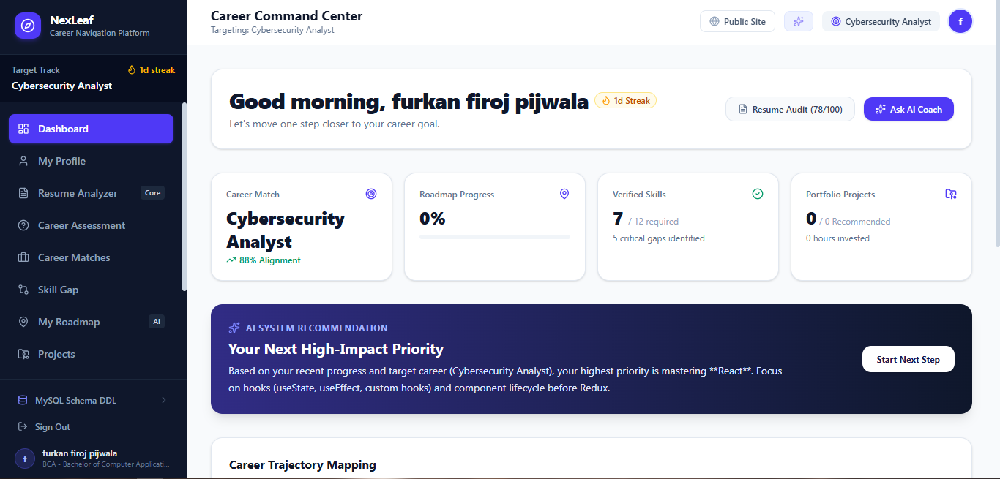
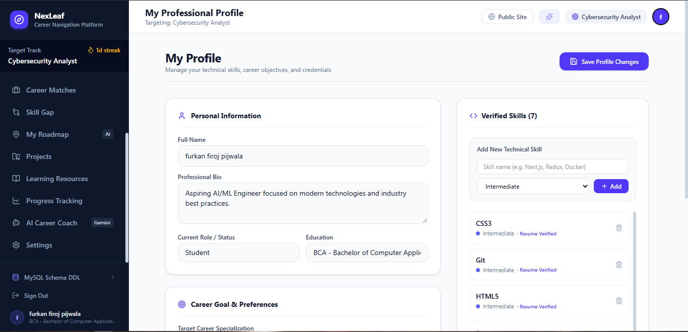
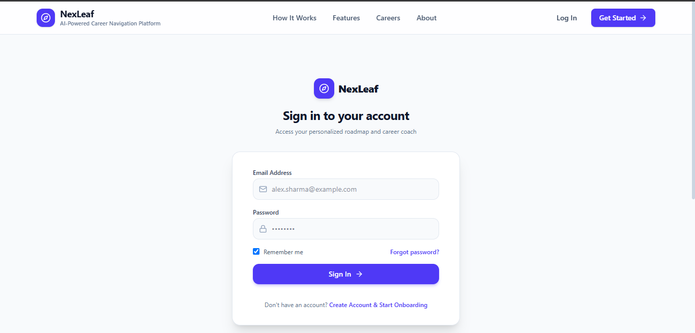

# NexLeaf – AI Career Navigator

An AI-powered career navigation platform that helps users explore career paths, identify skill gaps, analyze resumes, and plan their learning journey.

**Live demo:** _add your deployed link here_

## Features

- **Career Exploration:** browse career paths and the skills each one requires
- **AI Career Coach:** get career guidance powered by the Google Gemini API
- **Resume Analyzer:** upload a resume and get feedback
- **Skill Gap Analysis:** compare your skills with a target career
- **Learning Roadmap:** plan your preparation step by step
- **Career Recommendations:** discover options that match your profile
- **Projects and Courses:** find relevant projects and learning resources
- **User Accounts:** register and log in for personalized features

## Screenshots

| Landing Page | Dashboard |
| --- | --- |
|  |  |

| AI Career Coach | Profile |
| --- | --- |
|  |  |

| Login | Sign Up |
| --- | --- |
|  |  |

## Tech Stack

| Layer | Technologies |
| --- | --- |
| Frontend | React, TypeScript, Vite, Tailwind CSS |
| Backend | Node.js, Express, TypeScript |
| Database | MySQL |
| AI | Google Gemini API (`@google/genai`) |

## Project Structure

```
ai-career-navigator/
├── src/            # React frontend
├── server/         # Express backend code
├── server.ts       # Server entry point
├── database/       # SQL schema
├── screenshots/    # README images
└── .env.example    # Environment variable template
```

## Getting Started

### Prerequisites

- Node.js and npm
- MySQL Server
- A Google Gemini API key

### Installation

```bash
git clone https://github.com/Farhanpijwala/ai-career-navigator.git
cd ai-career-navigator
npm install
```

### Environment variables

Copy the template and fill in your own values:

```bash
cp .env.example .env
```

| Variable | Purpose |
| --- | --- |
| `GEMINI_API_KEY` | Google Gemini API key |
| `DB_HOST` | MySQL host (for example `localhost`) |
| `DB_USER` | MySQL username |
| `DB_PASSWORD` | MySQL password |
| `DB_NAME` | Database name (`nexleaf_db`) |
| `JWT_SECRET` | Secret used to sign login tokens |

> ⚠️ Replace the variable names in this table with the exact names in your `.env.example`. Never commit your real `.env` file.

### Database setup

1. Start your MySQL server.
2. Create the database: `CREATE DATABASE nexleaf_db;`
3. Run the schema: `database/schema.sql`

### Run the app

```bash
npm run dev
```

Open the local URL shown in the terminal.

## Roadmap

- [ ] Deploy frontend and backend
- [ ] Add automated tests
- [ ] Add GitHub Actions to run the build on every push
- [ ] Improve resume analysis with more detailed feedback
- [ ] Add a mobile-friendly layout pass

## Security

- `.env` files, API keys and passwords are never committed.
- Do not upload real private resumes or personal data while testing.
- The Gemini API key is used only on the server, never in frontend code.

## Author

**Farhan Pijwala**
[GitHub](https://github.com/Farhanpijwala) · [LinkedIn](https://www.linkedin.com/in/farhan-pijwala-63401631b) · [Portfolio](https://farhanpijwala.github.io/portfolio/)

## License

Released under the [MIT License](LICENSE). Add a `LICENSE` file from GitHub's "Add file → Create new file → LICENSE" template picker.
